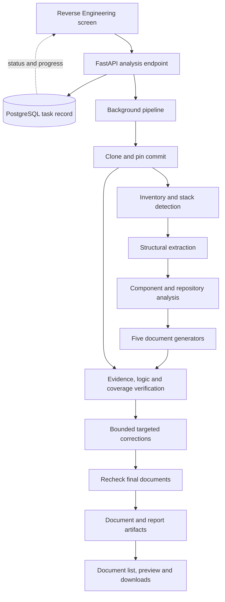

# AutoKT Reverse Engineering Demo: Architecture and Implementation Plan

Date: 2026-10-13  
Status: Demo implementation in progress; source analysis, documents, and deterministic verification implemented
Scope: Demo within the existing AutoKT application

## 1. Product objective

The user supplies a Git repository URL. AutoKT reads the repository, analyzes its structure and implemented behavior, and generates five documents:

1. System Overview & Architecture
2. Functional & Business Logic Documentation
3. Database & API Reference
4. Developer & Operations Guide
5. KT Plan & Handover Guide

The application displays a document list with generation status, verification status, preview, individual download, and download-all actions.

No separate business documents are required. Documentation already present in the repository may provide supporting context, but executable source, configuration, and declarations must be examined directly. Disagreements between documentation and code must be surfaced.

Success means producing useful, source-linked documentation for a representative demo repository, with explicit verification results. It does not mean proving complete understanding of every possible repository or language.

## 2. Agreed decisions and proposed defaults

### Confirmed requirements

- Build for a demo now; enhance the architecture later.
- Add the capability to AutoKT rather than create a separate product.
- Accept a repository link and return the five-document set.
- Read source only. Do not execute the repository, its tests, builds, startup scripts, or application imports.
- Include a system that checks the documents against source evidence and business logic.
- Discuss and document the architecture before starting implementation.

### Proposed demo defaults

- Start with publicly accessible HTTPS Git repositories and an optional branch/ref. Detect the default branch when omitted.
- Analyze one immutable checkout identified by its resolved commit SHA.
- Use existing GitPython, Tree-sitter, Pydantic, FastAPI, PostgreSQL, and the LLM abstraction.
- Use a sequential Python pipeline with bounded concurrent LLM calls where useful.
- Reuse the existing `tasks` table and FastAPI background-task pattern.
- Save run artifacts to a dedicated persistent local directory.
- Generate Markdown with Mermaid diagrams; render both in the frontend.
- Use one capable code-reasoning model initially, with a separately configurable verification model.
- Perform at most two correction rounds per document.
- Support one active demo analysis at a time initially to keep resource usage predictable.
- Keep graph/vector indexing optional for this workflow.

These defaults are implementation recommendations, not additional user requirements. Private repository authentication, PDF/DOCX export, and larger-scale execution can follow after the basic demo works.

## 3. What the demo will and will not establish

The output describes what the supplied source appears to implement at a particular commit. It must distinguish:

| Category | Example | Treatment |
|---|---|---|
| Source fact | A route declares a required request field | Cite the declaration and relevant registration context |
| Derived behavior | A handler validates input, calls a service, and writes a model | Cite the supporting execution path and conditions |
| Inference | A component appears to support customer onboarding | Label as inferred and cite the evidence |
| Recommendation | Spend 45 minutes studying the persistence layer | Label as a suggested KT activity/time estimate |
| Unknown | Production deployment settings are external to the repository | State that the information is unavailable |

Source analysis cannot establish original commercial intent, actual production state, successful startup, passing tests, or complete runtime behavior. Tests may be read as evidence of expected behavior, but must never be described as executed by this module.

## 4. Library and model choices

| Component | Decision | Reason |
|---|---|---|
| GitPython | Reuse | Already available for repository access; build a dedicated run checkout |
| Tree-sitter | Reuse and extend selectively | Extract symbols, imports, signatures, and source locations |
| Pydantic | Reuse | Validate analysis, claims, findings, and output contracts |
| Existing LLM client | Extend | Add structured responses, usage reporting, timeouts, and module-specific model selection |
| Plain Python pipeline | Use for demo | Explicit stages and errors with minimal orchestration overhead |
| LangGraph | Defer | Useful later for more complex stateful workflows; not a code-understanding engine |
| Repomix | Optional, not required | Can help package and count repository context, but existing readers may suffice |
| DeepWiki-Open | Reference implementation | Close to the repository-to-wiki use case, but a separate application rather than a drop-in verifier |
| Mermaid | Add to document preview | Architecture, sequence, state, and ER diagrams |
| Markdown renderer | Add to frontend | Render generated documents with safe links and raw HTML disabled |

Repomix compression removes implementation details. If adopted, do not use compressed signatures as the sole input for business-rule analysis. Preserve original source and file/line mappings. Adding its CLI would also introduce a Node runtime requirement in the backend environment.

### Model recommendation

Use a hosted code-reasoning model with sufficient context capacity and support for structured responses. Fine-tuning is unnecessary for the initial demo.

- Candidate balanced model discussed: `gpt-6.1-sol`.
- Candidate quality-prioritized analysis/review model: `gpt-6-astra`.
- The current application default is `gpt-5-mini`; retain existing behavior for other AutoKT features.
- Exact model selection depends on the provider/deployment available and a comparison on the demo repository.
- Availability in the OpenAI API does not establish availability in an Azure deployment.
- A separate reviewer call can initially use the same model, but agreement between two calls is not independent proof.

The provider adapter should expose model identity, validated structured output, token usage when available, and failure details. Invalid JSON, truncated output, or missing credentials must not silently become successful analysis. Stub mode is for tests and clearly labeled development previews only.

## 5. Proposed architecture



The central output is a shared repository analysis with source evidence. All five document generators consume that analysis and can retrieve the original source. They do not independently invent five descriptions of the system.

### Block A: Repository snapshot and inventory

1. Validate repository URL and optional ref.
2. Create a unique directory for the run; never share a checkout between concurrent requests.
3. Clone without executing project setup, hooks, submodule scripts, or build commands.
4. Resolve and save the commit SHA.
5. Inventory tracked files, languages, manifests, tests, configuration, migrations, and deployment files.
6. Record each file as analyzed, pending, excluded, unsupported, or failed, with a reason.
7. Detect missing submodules or externally generated sources and report them.

Skip binaries and generated/vendor directories by explicit rules. Include files such as `pom.xml`, Gradle files, TOML manifests, SQL migrations, Dockerfiles, and extensionless scripts when relevant; do not inherit the existing ingestion extension filter unchanged.

Preflight limits must cover repository size, source bytes, file count, per-file size, and model token budgets. A limit must cause an explicit failure or partial-analysis status, never silent truncation followed by a complete badge.

### Block B: Structural extraction

Produce a compact inventory of packages/components, symbols, imports, route candidates, data models, configuration access, and entry points.

Identity must include repository, commit, file, enclosing scope, symbol name, and signature where applicable. Two classes with `save()` methods must remain distinct. Java overloads must remain distinct.

Use deterministic parsing where supported. Retain unresolved imports and call targets instead of guessing. Framework-specific extraction should focus on the stack chosen for the demo.

### Block C: Shared repository analysis

Use two passes:

1. **Component analysis:** Read logical groups of files and produce structured summaries of responsibilities, interfaces, conditions, state changes, side effects, and source evidence.
2. **Repository synthesis:** Connect components into workflows and architecture; revisit original source where summaries are insufficient or inconsistent.

A repository summary must not be generated from only a few semantic-search hits. The file inventory determines coverage, and token-aware batches determine how the source is read.

Provide bounded read-only tools/helpers such as `list_files`, `read_source_range`, `search_source`, and `lookup_symbol`. They must resolve paths within the run checkout and must not execute repository code. Repository comments and documents are untrusted input, not instructions to the pipeline.

Model context should include full relevant implementations for business logic. Preserve source references through every summary. If a batch omits or cannot analyze files, record that fact and lower the completeness status.

### Block D: Document generation

Generate each document from a template, the shared analysis, relevant facts, and exact source excerpts. Use separate calls so one document can be corrected without regenerating the entire set.

For factual tables, prefer deterministic rendering of extracted records. Use the LLM for explanations and synthesis. Generate Mermaid using known entity/relationship identifiers; diagram syntax validity alone does not establish semantic correctness.

### Block E: Verification and correction

Run deterministic checks, business-logic review, coverage checks, and cross-document consistency checks. Findings feed a bounded correction loop. Recheck the final rendered content and its claims after each correction.

### Block F: Delivery

Persist document versions, claims, reports, and artifact references. Show documents as they become available, with generation and verification statuses kept separate. Allow downloads of drafts with visible warnings, but do not label unresolved documents as having passed checks.

## 6. Language support strategy

AutoKT can remain a Python backend while analyzing Java or other languages. Extraction depth depends on the grammar and framework adapter, not on the backend implementation language.

| Support level | Capability | Demo treatment |
|---|---|---|
| Text inspection | LLM reads source with file/line references | Useful but limited deterministic verification |
| Syntax extraction | Parser identifies symbols and declarations | Verify names, locations, and supported structures |
| Framework extraction | Adapter resolves supported routes/models/configuration | Verify supported contracts and framework relationships |
| Deeper semantic analysis | Types, bindings, and cross-file call targets | Future enhancement or selective implementation |

Existing Tree-sitter support covers Python, JavaScript, and TypeScript. Java requires a grammar and extraction work; adding a grammar alone does not establish Spring/JPA support.

The first demo repository and framework remain to be selected. Milestone 0 must establish the supported combination. Validate mixed-language repositories if the demo includes one. Expose the support level and unsupported areas in the analysis report.

## 7. Document specifications

| Document | Required sections | Verification focus |
|---|---|---|
| System Overview & Architecture | Purpose, stack, components, dependencies, entry points, integrations, interactions, diagrams | Component existence, supported edges, deployment/configuration evidence, labeled purpose inference |
| Functional & Business Logic | Features, happy paths, alternate/error paths, validations, state transitions, persistence effects | Preconditions, negation, thresholds, exceptions, side effects, cross-file context |
| Database & API Reference | Entities, fields, types, defaults, relationships, constraints/indexes, endpoints, request/response/error contracts | Source-level contracts, route registration, schema references, model/migration disagreements |
| Developer & Operations Guide | Prerequisites, dependencies, configuration, startup, tests, deployment, logging, troubleshooting | Commands and settings found in source; distinguish suggested troubleshooting from observed behavior |
| KT Plan & Handover Guide | Session sequence, prerequisites, source reading, exercises, checkpoints, suggested durations | Real source references and consistent dependencies; activities and durations labeled as recommendations |

If a repository has no API or database, explicitly state the detected scope and relevant limitations. Do not invent endpoints or tables to fill a template.

## 8. Verification subsystem

### 8.1 Claim and evidence records

Create claims during generation and perform a final claim audit so factual statements introduced in prose, tables, or diagrams are not left unchecked.

Example record shape:

```json
{
  "claim_id": "claim-014",
  "document_type": "business_logic",
  "section_id": "order-cancellation",
  "text": "Orders can be cancelled only while pending.",
  "category": "derived_behavior",
  "criticality": "high",
  "evidence": [
    {
      "file_path": "orders/service.py",
      "start_line": 80,
      "end_line": 104,
      "content_hash": "<hash of referenced source>"
    }
  ],
  "verdict": "insufficient_evidence",
  "checked_by": [],
  "reason": "Awaiting verification"
}
```

Bind all records to the run's commit SHA. Claims may need multiple evidence ranges, including callers, helper functions, middleware, configuration, and tests.

### 8.2 Deterministic checks

- Source paths, hashes, and line ranges resolve within the snapshot.
- Named symbols exist within the correct scope.
- Supported endpoint methods, combined paths, parameters, and schemas match extracted records.
- Supported model fields, types, defaults, and constraints match extracted records.
- Configuration names and declared startup commands have source evidence.
- Mermaid parses, and diagram entities/edges have evidence identifiers.
- Cross-document names, counts, and contracts remain consistent.

These are checks of supported extraction, not proofs that the extractor found every item. Unsupported patterns must be reported.

### 8.3 Business-logic review

Use a separate review call that receives the claim and actual source. It may retrieve surrounding code and dependencies independently of the generator's chosen evidence.

The rubric checks preconditions, branches, negations, thresholds, state changes, errors, and external/persistence effects. Require source references and a concise explanation for each verdict:

- `supported`: examined evidence supports the claim within the stated scope.
- `partially_supported`: the statement omits a necessary condition or qualification.
- `contradicted`: the examined implementation conflicts with the statement.
- `insufficient_evidence`: available source does not establish the statement.

Do not equate an LLM verdict with mathematical proof. Distinguish claims checked deterministically from those assessed by a model. Reading a test is evidence of expected behavior, not evidence that the test passes.

### 8.4 Completeness checks

Compare documents with an inventory built before generation:

- Detected endpoints versus documented endpoints.
- Detected models versus documented models.
- Detected entry points versus described workflows.
- Identified validations/error paths versus documented rules.
- Relevant configuration/deployment files versus operations coverage.

Use explicit denominators such as `documented_detected_endpoints / detected_endpoints`. Also show unsupported and unprocessed files. Do not call detected-item coverage whole-repository accuracy. A zero denominator is `not_applicable`, not automatically 100%.

### 8.5 Correction and release rules

1. Send the affected section, findings, and evidence to the generator.
2. Correct the section and rebuild affected claims/diagrams.
3. Recheck the revised content and cross-document implications.
4. Stop after the configured maximum, initially two rounds.

Recommended verification statuses:

| Status | Meaning |
|---|---|
| `pending` | Review has not completed |
| `checks_passed` | Required applicable checks completed; no unresolved blocking findings within the declared scope |
| `needs_review` | Unsupported claims, material omissions, contradictions, or analysis limitations remain |
| `verification_incomplete` | A required check failed to run or exceeded its budget |

Critical contradictions and unsupported critical behavior claims block `checks_passed`. Important omissions also block it; removing all difficult claims is not a route to passing. Inferences and recommendations must be labeled and reviewed as such.

The report shows counts by verdict/check method, detected-item coverage, scope limitations, and findings. Do not display an invented overall accuracy percentage.

## 9. Data and artifact design

### PostgreSQL

Reuse `Task` with `type = reverse_engineering`. No new database is required. A demo implementation can avoid new tables by keeping the run manifest in `Task.result` and larger artifacts on disk.

`Task.payload` contains normalized repository URL, requested ref, organization ID, requested document types, and analysis options. Never persist URL credentials or access tokens.

`Task.result` contains:

- Run/task ID, resolved commit, repository identity, and schema version.
- Current stage, phase counters, stage timestamps, and safe error information.
- File inventory counts, support levels, and exclusions.
- Provider/model and prompt/analyzer versions.
- Token usage when available, budget state, and timing.
- Document manifest: IDs, types, titles, generation status, verification status, version, artifact references.
- Summary findings and completion limitations.

For concurrent document calls, let one coordinator serialize task-manifest updates. Avoid workers overwriting each other's JSON results.

### Local artifacts

```text
backend/artifacts/reverse_engineering/<run_uuid>/
  manifest.json
  inventory.json
  extracted_facts.json
  repository_analysis.json
  evidence.json
  documents/
    system_overview.md
    business_logic.md
    database_api_reference.md
    developer_operations.md
    kt_handover.md
  verification/
    claims.json
    findings.json
    report.json
  bundle.zip
```

Use a separate run-specific temporary checkout. Retain it until verification completes; retain the evidence excerpts needed to inspect findings afterward. Artifacts must survive browser refresh and backend restart, using a persistent path/volume. Add generated artifacts to `.gitignore` during implementation.

Write files atomically and update the manifest only after the write succeeds. API clients request document IDs, never arbitrary server paths. All download paths are resolved from the run manifest and checked against the artifact root.

Existing Neo4j/Chroma data may supplement an analysis only when it matches the repository and snapshot. The new pipeline must not depend on existing ingestion, which currently deletes temporary clones and has graph/identity limitations.

## 10. API proposal

| Method | Endpoint | Purpose |
|---|---|---|
| POST | `/reverse-engineering` | Create analysis task; return HTTP 202 and task ID |
| GET | `/reverse-engineering/tasks/{task_id}` | Stage, progress counters, scope, and document manifest |
| GET | `/reverse-engineering/tasks` | List recent runs for the selected organization |
| GET | `/reverse-engineering/tasks/{task_id}/documents` | List the five documents and statuses |
| GET | `/reverse-engineering/tasks/{task_id}/documents/{document_id}` | Preview payload: Markdown, metadata, and findings summary |
| GET | `/reverse-engineering/tasks/{task_id}/documents/{document_id}/download` | Download Markdown |
| GET | `/reverse-engineering/tasks/{task_id}/verification` | Detailed verification report |
| GET | `/reverse-engineering/tasks/{task_id}/acceptance` | Run-level demo readiness checks and measured stage durations |
| GET | `/reverse-engineering/tasks/{task_id}/download` | Download completed artifacts and report as ZIP |

Proposed creation body:

```json
{
  "repo_url": "https://github.com/example/project",
  "organization_id": "demo-org",
  "ref": null
}
```

The five document types are fixed for the first demo. Advanced model and analysis settings remain server configuration rather than mandatory user inputs.

Use `pending`, `running`, `completed`, and `failed` for task execution. `completed` means the pipeline reached a terminal result; it does not mean all documents passed verification. Store per-document generation/verification statuses separately.

Reject malformed/unsupported URLs and over-budget requests explicitly. Handle unavailable repositories, clone failures, model errors, invalid structured output, missing artifacts, and interrupted tasks with actionable errors. Missing required documents must be reflected as partial/failed document generation, not hidden by task completion.

All new read/download routes must check task type and organization ownership recorded in the task. Caller-supplied organization IDs remain a demo limitation until real authentication exists; they are not an authorization boundary suitable for production.

## 11. Frontend flow

Add a `Reverse Engineering` navigation item with a dedicated screen and components, avoiding further concentration of feature logic in `App.tsx`.

1. Enter repository URL and optional ref.
2. Start analysis and display the task ID.
3. Display actual stages: cloning, inventory, extraction, analysis, generation, verification, correction, completion.
4. Display phase counters such as analyzed files or reviewed documents. Do not invent a smooth percentage from elapsed time.
5. Populate the document list as drafts become available.
6. Preview Markdown and Mermaid with source references and findings.
7. Download individual documents or the full bundle.
8. Restore the active task after refresh and allow opening recent runs.

Do not reuse the current fixed approximately four-minute polling limit unchanged. Use cancellable polling that handles longer runs and persists the task ID. Stopping browser polling must not imply cancellation of backend execution.

Disable raw HTML and unsafe links in Markdown; use Mermaid's restrictive rendering configuration. A visible `checks_passed` label must identify the scope of checks and must not read as a blanket accuracy certification.

## 12. Suggested source layout

```text
backend/app/api/reverse_engineering.py
backend/app/models/reverse_engineering.py
backend/app/reverse_engineering/
  pipeline.py
  repository.py
  inventory.py
  extractors.py
  source_reader.py
  analyzer.py
  generator.py
  verifier.py
  coverage.py
  artifacts.py
  prompts/
    component_analysis.txt
    repository_analysis.txt
    document_generation.txt
    business_logic_review.txt
    targeted_correction.txt
  templates/
    system_overview.md
    business_logic.md
    database_api_reference.md
    developer_operations.md
    kt_handover.md

frontend/src/reverse-engineering/
  api.ts
  types.ts
  ReverseEngineeringScreen.tsx
  AnalysisProgress.tsx
  DocumentList.tsx
  DocumentPreview.tsx
  VerificationPanel.tsx
```

Reuse existing helpers where their behavior fits. Review clone/path/identity handling before reuse. Preserve existing search, ingestion, onboarding, and health-score contracts.

## 13. Configuration and failure handling

Proposed settings:

```text
REVERSE_ENGINEERING_ENABLED
REVERSE_ENGINEERING_MODEL
REVERSE_ENGINEERING_REVIEW_MODEL
REVERSE_ENGINEERING_ARTIFACT_ROOT
REVERSE_ENGINEERING_MAX_ACTIVE_RUNS
REVERSE_ENGINEERING_MAX_FILES
REVERSE_ENGINEERING_MAX_FILE_BYTES
REVERSE_ENGINEERING_MAX_SOURCE_BYTES
REVERSE_ENGINEERING_MAX_INPUT_TOKENS_PER_CALL
REVERSE_ENGINEERING_MAX_TOTAL_TOKENS
REVERSE_ENGINEERING_LLM_TIMEOUT_SECONDS
REVERSE_ENGINEERING_MAX_CORRECTION_ROUNDS
```

Calibrate source/token limits using the selected repository and model in Milestone 0. Count tokens using a provider/model-appropriate method with output/reasoning headroom; the existing Nomic tokenizer is not the generator model's tokenizer.

Retry transient provider failures with bounded backoff. Stop on exhausted budgets and persist the partial result and findings. Reserve budget for verification; generation must not consume the entire allowance and leave unchecked documents labeled ready.

The background runner must update task state in a top-level exception handler and clean up run-owned temporary files. An interrupted run may require restarting from the beginning in this demo. Detect stale active tasks on startup and mark them interrupted/failed; do not leave them apparently running forever. Automatic resume, distributed queues, and multi-worker recovery are deferred.

For repository handling, enforce checkout path boundaries and safe remote URL handling. Do not follow symlinks outside the checkout. Exclude credential-bearing files and redact detected secrets from prompts/artifacts. Repository text must not override analysis instructions. These are small controls needed for a repository-reading service, not a separate enterprise-hardening project.

## 14. Implementation milestones

Implementation status as of 2026-10-13:

- Repository intake, commit pinning, inventory, task persistence, and run artifacts are implemented.
- Deterministic structural extraction is implemented for Python, JavaScript, TypeScript, and Java. It records qualified symbols, imports, routes, models, configuration keys, entry points, dependencies, component interactions, coverage, uncertainties, and source evidence.
- Python uses the standard-library AST. JavaScript, TypeScript, and Java currently use bounded structural patterns and label route confidence; broader parser adapters remain part of the language-expansion work.
- Shared repository synthesis and all five Markdown document drafts are implemented. Optional configured-model enrichment adds bounded purpose and architecture/business narratives; deterministic facts, tables, diagrams, source references, and draft claims remain the authority.
- Deterministic verification is implemented against the pinned checkout, extracted facts, evidence paths/ranges/hashes, required sections, commit identity, Markdown safety, and endpoint/model/entry-point/dependency/configuration/behavior coverage. Exact final-document contract checks compare rendered endpoint rows, model fields and metadata, error evidence, workflow facts, behavior counts, and Mermaid nodes and edges with the shared source-derived analysis.
- Fixable document findings trigger targeted regeneration for at most the configured correction rounds, followed by full rechecking. Claim verdicts, findings, reports, corrected versions, and per-document verification statuses are persisted and displayed.
- A verifier execution failure preserves generated documents, labels them `verification_incomplete`, and persists the failure as a critical finding instead of presenting unchecked output as verified.
- Individual preview, Markdown download, ZIP bundle download, recent-run retrieval, and detailed verification APIs are implemented.
- Browser previews render GFM Markdown and Mermaid diagrams with raw HTML disabled, external images blocked, safe URL protocols, and Mermaid strict security mode.
- Startup recovery marks stale active analyses as interrupted, and run-owned temporary checkouts are removed after terminal completion while persistent artifacts remain available.
- Run-level rehearsal reporting evaluates ten explicit acceptance checks, records observed analysis-stage durations, exposes `ready`, `needs_review`, or `not_ready`, appears in recent runs and the UI, and is included in the downloadable artifact bundle.

### Milestone 0: Fix the demo target and quality baseline

- Select one primary repository and one small contrasting fixture.
- Confirm public/private access requirements, language/framework, and repository size.
- Confirm an available LLM provider/deployment and run a small structured-output request.
- Compare candidate model output on representative code.
- Create a human-reviewed checklist of roughly 20-30 important facts/rules spanning endpoints, models, validations, failure paths, and setup.
- Identify unsupported behavior and set initial resource budgets.

Exit: A documented target stack, available model, realistic scope, and reference checklist.

### Milestone 1: End-to-end task and artifact skeleton

- Add request/result schemas and routes.
- Create PostgreSQL tasks, background execution, stage reporting, and manifests.
- Clone to a unique checkout, pin the commit, and inventory files.
- Add run-specific artifact storage and cleanup.

Exit: A URL creates a traceable analysis run with a valid inventory and recoverable status; no generated documentation claims yet.

### Milestone 2: Extraction and shared analysis

- Extract supported structures with source locations and qualified identities.
- Add bounded source retrieval and component grouping.
- Implement component analysis and repository synthesis using validated schemas.
- Persist source evidence, coverage, uncertainties, versions, and model usage.

Exit: The shared analysis matches the reviewed repository checklist closely enough to proceed; known gaps are explicit.

### Milestone 3: Five document drafts

- Implement the five templates and separate generation calls.
- Render factual tables from records where possible.
- Generate claims and evidence alongside prose and diagrams.
- Store individual drafts and a manifest.

Exit: All five documents are available as clearly unverified drafts, with source references and no invented template filler.

### Milestone 4: Verification and correction

- Implement deterministic checks and independent source-based logic review.
- Add completeness and cross-document consistency checks.
- Add bounded corrections and final-text rechecks.
- Persist finding severity, evidence, verdicts, and check methods.
- Enforce document verification status rules.

Exit: Deliberately incorrect documents trigger the expected findings, and unresolved problems remain visible.

### Milestone 5: Demo UI and exports

- Add URL input, progress, recent runs, document cards, previews, and verification panel.
- Add Markdown/Mermaid rendering and individual/ZIP downloads.
- Support refresh recovery and longer-running polling.
- Present partial failures without discarding successful documents.

Exit: A user can complete the entire URL-to-document-list flow through the UI.

### Milestone 6: Rehearsal and acceptance

- Run the primary demo repository from a fresh task.
- Compare final documents with the independent checklist.
- Exercise errors: missing repository, provider failure, budget exhaustion, invalid output, and interrupted execution.
- Record observed latency, token usage, and limitations rather than estimating performance from model context size.
- Confirm existing AutoKT workflows still work.

Exit: The acceptance checklist below passes, with any remaining limitations documented.

## 15. Validation and acceptance criteria

### Feature acceptance

- [ ] Repository URL produces all five document entries, with explicit status for each.
- [ ] Analysis records a commit SHA and an inventory of included/excluded/failed files.
- [ ] No repository code, build, test, or startup script is executed.
- [ ] Documents have useful repository-specific content and valid source references.
- [ ] Required sections are present or explicitly marked unsupported/not applicable.
- [ ] Browser preview and Markdown/ZIP downloads work.
- [ ] Progress and errors are truthful; browser refresh restores the run.
- [ ] Existing AutoKT API and frontend behavior remains intact.

### Verification acceptance

- [ ] Claims are checked against the same source snapshot used for analysis.
- [ ] Final prose, tables, and diagrams are covered by the claim audit.
- [ ] Wrong route methods/paths, required-field mistakes, and invalid references are detected in fixtures.
- [ ] Inverted conditions, omitted exceptions, and unsupported side effects are detected in reviewed examples.
- [ ] Missing important endpoints/workflows produce completeness findings.
- [ ] Unsupported language/framework areas prevent misleading completeness claims.
- [ ] A reviewer/provider failure produces `verification_incomplete`.
- [ ] Corrections trigger rechecking; unresolved critical findings block `checks_passed`.
- [ ] Inferred purpose, suggested KT timings, and unexecuted commands are labeled appropriately.
- [ ] The report distinguishes model-assessed support from deterministic checks.

### Test design

Use small repository fixtures with known routes, models, configuration, and business rules. Include duplicated method names, cross-file calls, conditional behavior, and malformed/unsupported files relevant to the selected stack.

Test the verifier by deliberately changing a correct document: swap GET/POST, invert a condition, alter a threshold, remove an exception, claim immediate completion of a queued action, and invent a diagram edge. Also include correct claims so a verifier that rejects everything cannot pass.

Measure detection and false-alarm rates against human labels. Keep reference checklists independent of the generation output, and retain a small held-out fixture set. Read-only tests within submitted repositories are not executed; tests of AutoKT's own implementation are still expected during development.

## 16. Deferred enhancements

- Private repository credential management and broader Git-host support.
- Comprehensive Java/Spring and other language/framework semantic adapters.
- Compiler-backed type resolution and stronger cross-file control/data-flow analysis.
- Optional sandboxed runtime/build/test verification, only after explicitly expanding source-only scope.
- Durable queue/worker execution, automatic resume, and multi-user concurrency.
- Incremental analysis across commits and document change tracking.
- Full snapshot-aware Neo4j/Chroma integration.
- PDF/DOCX export and richer handover collaboration.
- Production authentication, authorization, auditing, and artifact retention policies.

## 17. Open choices before implementation

1. Which exact repository and language/framework will be demonstrated?
2. Which model/provider deployment is available for real calls?
3. Is public HTTPS access sufficient for the first demo?
4. Are Markdown downloads and browser previews sufficient, or is PDF required for the presentation?

Default to the proposed choices in this plan where possible. Confirm the repository and provider in Milestone 0 because they determine meaningful extraction coverage and measured quality.

## 18. Reference material

These references informed the design. Model names and provider availability must be checked against the deployment actually used during implementation.

- [Repomix usage](https://repomix.com/guide/usage) and [compression behavior](https://repomix.com/guide/code-compress): repository packaging; compression removes implementation details.
- [DeepWiki-Open](https://github.com/AsyncFuncAI/deepwiki-open): repository-to-wiki application and diagrams.
- [Tree-sitter](https://tree-sitter.github.io/tree-sitter/): syntax parsing foundation.
- [LangGraph overview](https://docs.langchain.com/oss/python/langgraph/overview): orchestration capabilities, if needed later.
- [Mermaid](https://mermaid.js.org/intro/): text-based diagram rendering.
- [OpenAI model catalog](https://developers.openai.com/api/docs/models): model candidates and documented roles discussed during planning.
- [OpenAI evaluation best practices](https://developers.openai.com/api/docs/guides/evaluation-best-practices): task-specific evaluation and calibration against human judgments.
- [CodeQL data-flow overview](https://codeql.github.com/docs/writing-codeql-queries/about-data-flow-analysis/): distinction between syntax and behavioral analysis, and static-analysis limits.

## 19. Implementation handoff

Continue with the remaining demo milestones after validating the current source-analysis, generation, and verification path against the selected representative repository.
